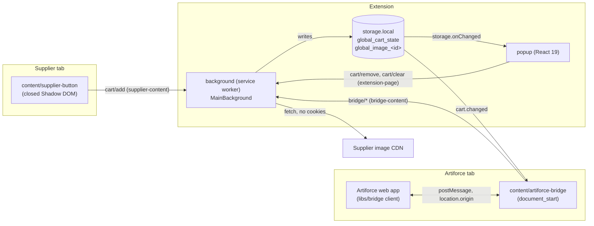

# Architecture

The extension has four execution contexts. Each feature folder in
`apps/browser/src` (`cart`, `capture`, `images`, `bridge`, `suppliers`) splits
its code by context, as in Bitwarden's browser extension
([ADR-001](adr/ADR-001-bitwarden-layout-webpack-swc.md)).

## Contexts

| Context                 | Entry                                                 | Role                                                               | May import                                                                       |
| ----------------------- | ----------------------------------------------------- | ------------------------------------------------------------------ | -------------------------------------------------------------------------------- |
| Service worker          | `src/background.ts` → `background/main.background.ts` | Owns all writes: cart, images, badge, purge alarm, message router. | `platform`, feature `services`, `background`, `models`, libs (DOM-free entries). |
| Supplier content script | `capture/content/supplier-button.ts`                  | Button on product pages; extracts the product on click.            | `platform`, feature roots, `libs/suppliers`. No React.                           |
| Bridge content script   | `bridge/content/artiforce-bridge.ts`                  | Relays the web app's requests, posts `cart.changed`.               | `platform`, feature roots, `libs/bridge`. No React.                              |
| Popup                   | `popup/main.tsx`                                      | « Ma sélection », suppliers, help. Reads state, sends commands.    | `platform`, feature roots, `popup`, React, Phosphor.                             |

ESLint enforces the import rules; `tsconfig.background.json` type-checks the
service worker against the `WebWorker` lib.

## Platform

- `platform/browser/browser-api.ts`: the only code that touches `chrome.*`.
- `platform/messaging`: `defineCommand({ name, request, response, senders })`;
  `classifySender` turns the browser-provided sender into `extension-page`,
  `supplier-content`, `bridge-content` or `unknown`; `MessageRouter` is the
  single `onMessage` listener (envelope, sender kind, request schema, `ready`,
  handler, response schema); `sendCommand` validates the answer.
- `platform/state`: `StateDefinition` (disk = `storage.local`, memory =
  `storage.session`), `KeyDefinition` with a Zod schema and a default,
  `GlobalState` (`get`, `update` under a mutex, `subscribe`). Only the
  background provider can write.
- `platform/logging`, `platform/i18n` (`t()` typed from `_locales/fr`),
  `platform/config` (build-time config validated at startup),
  `platform/concurrency` (`Mutex`).

## Service worker lifecycle

1. `new MainBackground()` builds every service in order (log, config, state,
   cart, images, badge, router, handlers): no async work.
2. `main.listen()` registers `runtime.onMessage`, `alarms.onAlarm` and the
   storage subscriptions synchronously, at the top level (MV3 drops events for
   listeners added later).
3. `main.bootstrap()` purges expired items, refreshes the badge, ensures the
   `cart-purge` alarm (60 min), deletes orphan images and resumes `pending`
   downloads, then resolves `ready`. Every handler awaits `ready`.

Storage is the source of truth; nothing relies on in-memory state surviving a
service worker restart.

## Capture flow

1. The supplier content script runs at `document_idle` on registry hosts. It
   finds the supplier, checks the page is a product page (adapter or
   structured data + `productPath`), and mounts the button: an unregistered
   `artiforce-btn-<random>` element with `all: initial !important`, a closed
   shadow root and an adopted stylesheet, after the adapter's anchor or
   floating bottom right.
2. A debounced `MutationObserver` follows SPA navigations and re-injects a
   removed button (more than 30 times a minute: floating).
3. On click, `extractProduct` runs JSON-LD → microdata → meta → adapter
   `refine`, then Zod (`CapturedProduct`). The button sends `cart/add`.
4. The background derives the supplier from `sender.url` (never from the
   message), deduplicates (supplier + reference, else canonical URL), applies
   the 7-day expiry and the 100-item cap, and queues the image.

## Import flow

See [bridge-protocol.md](bridge-protocol.md): `hello`, `getCart`,
`getImages`, then `removeItems` after a successful import.

## Libraries

- `libs/suppliers`: registry (`suppliers.json`), price/GTIN/URL/unit parsing,
  extraction chain and adapters. Pure TS + DOM. `…/registry` is the DOM-free
  entry used by the service worker.
- `libs/bridge`: protocol schemas and the web app client. Zod only. `…/wire`
  is the DOM-free entry.
